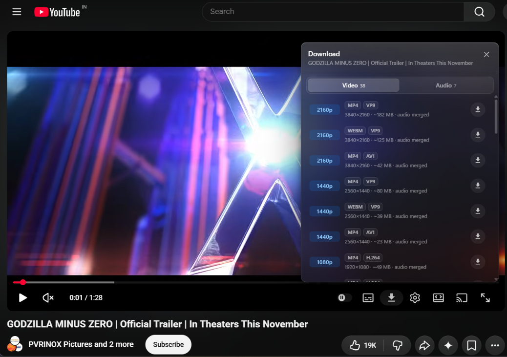

# YouTube Downloader — Chrome extension

A Chrome extension that adds a download button directly to the YouTube player controls. Click it to see every available video resolution and audio track, then download with one click.

The extension is the UI. A small local helper (Node.js + [yt-dlp](https://github.com/yt-dlp/yt-dlp)) does the actual downloading, so HD video, separate audio tracks and automatic muxing all work reliably.



## Features

- **In-player button** — appears in the YouTube control bar next to the settings button on any `/watch` page.
- **Full format picker** — every resolution and codec YouTube offers, with file size, FPS, HDR and codec badges.
- **Video and Audio tabs** — pick a video resolution (audio is merged in automatically) or download just the audio track.
- **Live progress** — download speed, ETA and percentage shown in the panel while yt-dlp works.
- **Cancel anytime** — stop a running job from the panel; the helper kills the process and cleans up.
- **Saved to Downloads** — finished files are handed to Chrome's normal download manager and confirmed once Chrome reports them complete.
- **Safe edge cases** — live streams are flagged, video-only formats are disabled when ffmpeg is missing, and concurrent jobs are capped.
- **No account, no tracking** — the helper runs on `127.0.0.1` and only talks to YouTube.
- **SPA-aware** — keeps working as you navigate between videos without a page reload.

## Requirements

| Tool | Why | Install (Windows) |
| --- | --- | --- |
| Node.js 18+ | runs the local helper | `winget install OpenJS.NodeJS.LTS` |
| yt-dlp | extracts and downloads streams | `winget install yt-dlp.yt-dlp` |
| ffmpeg | merges HD video + audio | `winget install Gyan.FFmpeg` |

On macOS/Linux install the same three tools with your package manager (`brew install node yt-dlp ffmpeg`, `sudo apt install nodejs ffmpeg` + the yt-dlp binary).

## Install

### 1. Start the companion

Double-click `server\start.bat` (Windows) or run:

```bash
cd server
node server.js
```

Keep the window open. It listens on `http://127.0.0.1:8765`.

### 2. Load the extension

1. Open `chrome://extensions`.
2. Enable **Developer mode**.
3. Click **Load unpacked** and select this `youtube-downloader` folder.
4. Pin the extension if you want quick access to settings.

### 3. Use it

1. Open any YouTube video and start playing.
2. Click the download icon in the player controls.
3. Pick a resolution or audio track.

The first time a video is opened the helper extracts formats, which can take a few seconds. The panel shows a skeleton while that happens.

## Settings

Click the extension icon:

- **Companion URL** — change the port if `8765` is taken. Use `http://127.0.0.1:<port>`.
- **Connection test** — shows whether the helper and yt-dlp are reachable.
- **Setup guide** — opens the built-in walkthrough.

Settings are stored with `chrome.storage.local`.

## How it works

```
YouTube page
  └─ content.js  (adds the button + panel, polls job progress)
       │ chrome.runtime messages
       ▼
  background.js (extension service worker, fetches the helper)
       │ HTTP on 127.0.0.1:8765
       ▼
  server/server.js
       ├─ POST /api/formats   → yt-dlp -J
       ├─ POST /api/download  → yt-dlp -f … (merges with ffmpeg)
       ├─ GET  /api/jobs/:id  → progress
       ├─ POST /api/jobs/:id/cancel → stop a job and clean up
       └─ GET  /api/jobs/:id/file → hands the file to chrome.downloads
```

The extension never implements YouTube's signature handling itself. yt-dlp is the maintained component, so when YouTube changes something you only update yt-dlp (`yt-dlp -U`).

## Troubleshooting

| Symptom | Fix |
| --- | --- |
| "Companion app is offline" | Start `server\start.bat`; confirm the port matches the popup setting; press Retry in the panel. |
| Button missing | Reload the YouTube tab. The button only appears on `/watch` pages with a player. |
| `yt-dlp` error on a specific video | Run `yt-dlp -U`, then retry. Age-restricted or members-only videos can still fail. |
| No 1080p+ options | The upload may not have them, or the higher tiers may be unavailable to signed-out clients. |
| Merge fails | Install ffmpeg and restart the helper. |
| Port already in use | Set `PORT=8766` before starting the server and update the popup URL. |

## Privacy and security

- The helper binds to `127.0.0.1` only and is not reachable from the network.
- It accepts only `youtube.com` / `youtu.be` URLs, so it cannot be used as a general proxy.
- Requests are accepted only from extension origins (plus local tools without an `Origin` header).
- No analytics, accounts or external servers.

## Legal

Downloading content may violate YouTube's Terms of Service and copyright law. Use this only for content you own or have explicit permission to download. The authors are not responsible for misuse.

## Project layout

```
youtube-downloader/
├─ manifest.json          MV3 manifest
├─ icons/                 extension icons
├─ src/
│  ├─ content.js          player button, format panel, progress polling
│  ├─ styles.css          panel + button styling (YouTube dark theme)
│  ├─ background.js       messaging + companion HTTP client + downloads
│  ├─ popup.html/js       settings and connection test
│  └─ setup.html          built-in setup guide
└─ server/
   ├─ server.js           zero-dependency Node helper around yt-dlp
   ├─ start.bat           Windows launcher
   └─ package.json
```
